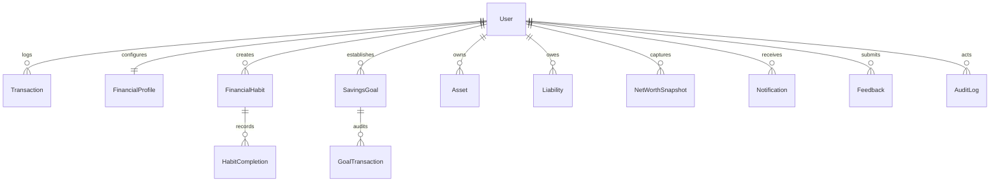

# Database Schema & Entity Relationship Documentation

This document describes the 13 Mongoose models implemented in the Financial Habit Builder & Wealth Growth Tracker.

---

## 1. Entity Relationship Overview

---

## 2. Models Specification

### 2.1 User (`users`)
| Field | Type | Attributes | Description |
| :--- | :--- | :--- | :--- |
| `_id` | ObjectId | Primary Key | Unique user identifier |
| `name` | String | Required, Trimmed | Full user name |
| `email` | String | Required, Unique, Lowercase | Normalized email address |
| `password` | String | Required, Min length 6, `select: false` | Bcrypt hashed password |
| `phone` | String | Optional, Trimmed | Contact phone number |
| `role` | String | Enum: `['user', 'admin']`, Default: `'user'` | Role-based authorization |
| `status` | String | Enum: `['active', 'suspended']`, Default: `'active'` | Account moderation status |
| `createdAt` / `updatedAt` | Date | Timestamps | Audit timestamps |

---

### 2.2 FinancialProfile (`financialprofiles`)
| Field | Type | Attributes | Description |
| :--- | :--- | :--- | :--- |
| `_id` | ObjectId | Primary Key | Unique profile identifier |
| `user` | ObjectId | Ref: `User`, Required, Unique Index | Owner reference |
| `preferredCurrency` | String | Enum: `['INR', 'USD', 'EUR', 'GBP']`, Default: `'INR'` | Currency representation |
| `monthlyBudget` | Number | Min: 0, Default: 0 | Spending threshold alert level |
| `savingsTargetMonthly` | Number | Min: 0, Default: 0 | Monthly savings ambition |
| `timezone` | String | Default: `'Asia/Kolkata'` | Date-time calculation context |
| `notificationPreferences` | Object | Sub-document | In-app, email, and reminder toggles |

---

### 2.3 Transaction (`transactions`)
| Field | Type | Attributes | Description |
| :--- | :--- | :--- | :--- |
| `_id` | ObjectId | Primary Key | Unique transaction record |
| `user` | ObjectId | Ref: `User`, Required, Indexed | Record owner |
| `type` | String | Enum: `['income', 'expense']`, Required | Transaction inflow or outflow |
| `amount` | Number | Required, Min: 0.01, 2-decimal rounded | Monetary value |
| `currency` | String | Default: `'INR'` | Stored currency symbol |
| `category` | String | Required, Trimmed, Indexed | e.g. Salary, Rent, Food, Utilities |
| `description` | String | Maxlength 200 | Description of expense or income |
| `date` | Date | Required, Default: Date.now, Indexed | Transaction timestamp |
| `paymentMethod` | String | Enum: `['cash', 'upi', 'card', 'bank_transfer', 'other']` | Channel |
| `isInternalTransfer` | Boolean | Default: `false` | Distinguishes transfers from consumption |
| `notes` | String | Maxlength 500 | Optional contextual notes |

**Indexes:**
- `{ user: 1, date: -1 }` (Date range cashflow queries)
- `{ user: 1, type: 1, date: -1 }` (Income vs expense segregation)
- `{ user: 1, category: 1 }` (Category breakdown aggregation)

---

### 2.4 FinancialHabit (`financialhabits`)
| Field | Type | Attributes | Description |
| :--- | :--- | :--- | :--- |
| `_id` | ObjectId | Primary Key | Unique habit identifier |
| `user` | ObjectId | Ref: `User`, Required, Indexed | Habit owner |
| `name` | String | Required, Trimmed, Max 100 | Habit label (e.g. Record daily expenses) |
| `description` | String | Maxlength 300 | Implementation rules |
| `frequency` | String | Enum: `['daily', 'weekly', 'monthly']`, Default: `'daily'` | Recurrence schedule |
| `targetCountPerPeriod` | Number | Default: 1 | Completions required per cycle |
| `reminderTime` | String | Default: `'20:00'` | Scheduled alert time (HH:MM) |
| `status` | String | Enum: `['active', 'paused', 'archived']`, Default: `'active'` | Operational status |
| `currentStreak` | Number | Default: 0, Min: 0 | Ongoing consecutive completion count |
| `longestStreak` | Number | Default: 0, Min: 0 | Historic record streak |
| `totalCompletions` | Number | Default: 0, Min: 0 | Lifetime completions count |
| `lastCompletedPeriod` | String | Default: null | Period key of last completion |

---

### 2.5 HabitCompletion (`habitcompletions`)
| Field | Type | Attributes | Description |
| :--- | :--- | :--- | :--- |
| `_id` | ObjectId | Primary Key | Completion log entry |
| `user` | ObjectId | Ref: `User`, Required, Indexed | Completing user |
| `habit` | ObjectId | Ref: `FinancialHabit`, Required, Indexed | Target habit reference |
| `periodKey` | String | Required, Format: `YYYY-MM-DD`, `YYYY-Www`, `YYYY-MM` | Period marker |
| `completedAt` | Date | Default: Date.now | Actual completion timestamp |
| `notes` | String | Maxlength 300 | Optional reflection note |

**Unique Index:**
- `{ habit: 1, periodKey: 1 }` — Guarantees that a habit cannot be marked complete twice for the same period.

---

### 2.6 SavingsGoal (`savingsgoals`)
| Field | Type | Attributes | Description |
| :--- | :--- | :--- | :--- |
| `_id` | ObjectId | Primary Key | Goal identifier |
| `user` | ObjectId | Ref: `User`, Required, Indexed | Owner |
| `name` | String | Required, Trimmed, Max 100 | Goal title |
| `targetAmount` | Number | Required, Min: 1, 2-decimal rounded | Financial target |
| `currentAmount` | Number | Default: 0, Min: 0, 2-decimal rounded | Progress balance |
| `targetDate` | Date | Required | Target deadline |
| `priority` | String | Enum: `['low', 'medium', 'high']`, Default: `'medium'` | Importance level |
| `status` | String | Enum: `['in-progress', 'completed', 'paused', 'archived']` | Status |
| `category` | String | Enum: e.g. `'Emergency Fund'`, `'Tech & Gadgets'` | Classification |

---

### 2.7 GoalTransaction (`goaltransactions`)
| Field | Type | Attributes | Description |
| :--- | :--- | :--- | :--- |
| `_id` | ObjectId | Primary Key | Transaction audit log |
| `user` | ObjectId | Ref: `User`, Required, Indexed | User |
| `goal` | ObjectId | Ref: `SavingsGoal`, Required, Indexed | Associated savings goal |
| `type` | String | Enum: `['contribution', 'withdrawal', 'adjustment']` | Inflow or outflow |
| `amount` | Number | Required, Min: 0.01 | Value transferred |
| `balanceAfter` | Number | Required, 2-decimal rounded | Goal balance after transaction |
| `date` | Date | Default: Date.now | Transaction date |

---

### 2.8 Asset (`assets`)
| Field | Type | Attributes | Description |
| :--- | :--- | :--- | :--- |
| `_id` | ObjectId | Primary Key | Asset record |
| `user` | ObjectId | Ref: `User`, Required, Indexed | Holding owner |
| `name` | String | Required, Trimmed, Max 100 | Asset name |
| `category` | String | Enum: Cash, Bank Savings, Fixed Deposits, Investments, etc. | Asset classification |
| `currentValue` | Number | Required, Min: 0, 2-decimal rounded | Current valuation |
| `valuationDate` | Date | Default: Date.now | Valuation date |
| `notes` | String | Maxlength 300 | Valuation context |

---

### 2.9 Liability (`liabilities`)
| Field | Type | Attributes | Description |
| :--- | :--- | :--- | :--- |
| `_id` | ObjectId | Primary Key | Debt record |
| `user` | ObjectId | Ref: `User`, Required, Indexed | Debtor reference |
| `name` | String | Required, Trimmed, Max 100 | Debt label |
| `category` | String | Enum: Credit Card, Education Debt, Personal Loan, etc. | Classification |
| `outstandingAmount` | Number | Required, Min: 0, 2-decimal rounded | Debt balance |
| `interestRatePercent` | Number | Default: 0, Min: 0, Max: 100 | Annual interest rate (APR) |
| `dueDate` | Date | Optional | Statement due date |

---

### 2.10 NetWorthSnapshot (`networthsnapshots`)
| Field | Type | Attributes | Description |
| :--- | :--- | :--- | :--- |
| `_id` | ObjectId | Primary Key | Snapshot record |
| `user` | ObjectId | Ref: `User`, Required, Indexed | User |
| `snapshotDate` | Date | Default: Date.now | Valuation timestamp |
| `dateKey` | String | Required, Format: `YYYY-MM` | Snapshot monthly key |
| `totalAssets` | Number | Required, Min: 0 | $\sum \text{Assets}$ |
| `totalLiabilities` | Number | Required, Min: 0 | $\sum \text{Liabilities}$ |
| `netWorth` | Number | Required | $\text{Assets} - \text{Liabilities}$ |
| `assetBreakdown` | Array | Category & Amount sub-documents | Asset allocation at date |
| `liabilityBreakdown` | Array | Category & Amount sub-documents | Debt allocation at date |

**Unique Index:** `{ user: 1, dateKey: 1 }` (One snapshot per calendar month).

---

### 2.11 Notification (`notifications`)
Stores in-app alerts for milestone completions, budget thresholds, and habit reminders. Indexed on `{ user: 1, isRead: 1, createdAt: -1 }`.

### 2.12 Feedback (`feedbacks`)
Stores user submissions, bug tickets, and complaints. Separates user-visible `resolutionNotes` from private administrator `internalNotes`.

### 2.13 AuditLog (`auditlogs`)
Tracks all privileged administrative operations (user suspensions, ticket resolutions, admin logins) with safe metadata, excluding passwords or sensitive personal finances.
